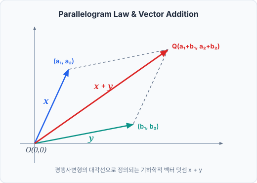
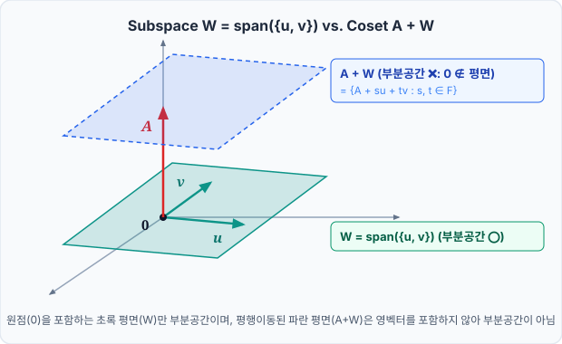
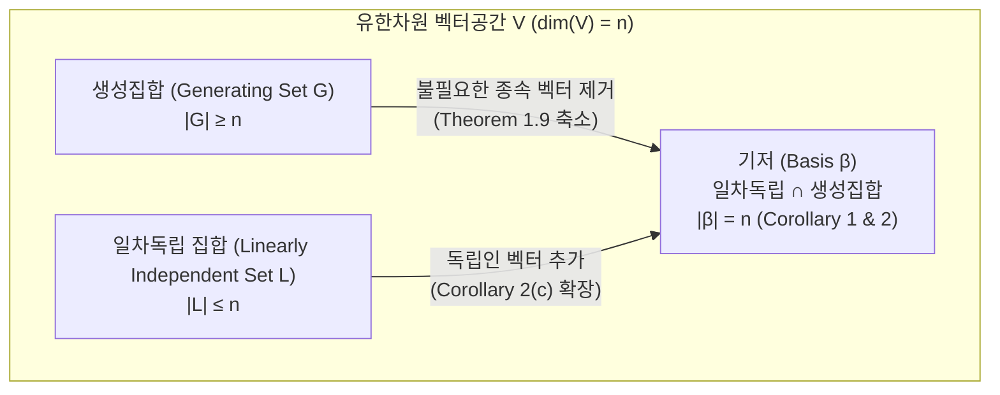
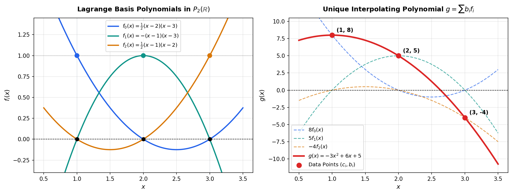

# Presentation — Vector Spaces: Axioms, Subspaces, and the Theory of Dimension

- **Presenter:** Presenter A (@kisbi3)
- **Date:** 2026-10-19
- **Textbook:** Linear Algebra (5th Edition, Stephen H. Friedberg, Arnold J. Insel, Lawrence E. Spence)
- **Chapters / Sections:** Chapter 1 (Sec 1.1 ~ Sec 1.7*)

---

## 0. Overview & Motivation

- **핵심 질문:** 물리적 공간의 화살표(힘, 속도)가 가지는 기하학적 연산 법칙을 추상화하여 함수, 다항식, 행렬 등 일반적인 수학적 대상에 공통으로 적용되는 **'선형성(Linearity)의 무대'**와 **'차원(Dimension)의 불변성'**을 어떻게 엄밀하게 구축할 수 있는가?
- **전체 흐름:** 물리적 벡터의 기하학적 직관(Sec 1.1) $\to$ 체(Field) 위의 벡터공간 공리화 및 부분공간 판정(Sec 1.2~1.3) $\to$ 생성(Span)과 일차독립을 통한 최소 생성집합 탐색(Sec 1.4~1.5) $\to$ 대체 정리(Replacement Theorem)를 통한 기저(Basis)와 차원(Dimension)의 확립(Sec 1.6) $\to$ 하우스도르프 극대 원리를 통한 무한차원 기저의 존재성 증명(Sec 1.7*)

> 🌉 **Bridge (0절 $\to$ 1절):**  
> 우리는 먼저 물리적 공간의 화살표(힘, 속도)에서 관찰되는 덧셈과 스칼라배의 기본 성질을 8가지 공리로 추상화하여, 모든 선형적 수학 대상이 활동할 '우주(Vector Space)'를 세우는 작업부터 시작합니다.

---

## 1. Sec 1.1 ~ 1.2 Introduction & Vector Spaces

### Concept / Setup

> **📌 Definition (Vector Space over a Field $F$):**  
> 체(Field) $F$ 위의 **벡터공간(Vector Space)** $V$는 두 연산 **덧셈(Addition, $x+y \in V$)**과 **스칼라 곱(Scalar Multiplication, $ax \in V$)**이 정의되어 아래 8가지 공리 **(VS 1)~(VS 8)**을 만족하는 집합이다 (단, $x, y, z \in V$는 **벡터**, $a, b \in F$는 **스칼라**).

- **덧셈에 관한 공리 (Abelian Group 구조):**
  - **(VS 1) 교환법칙:** $x + y = y + x$
  - **(VS 2) 결합법칙:** $(x + y) + z = x + (y + z)$
  - **(VS 3) 덧셈 항등원(영벡터, Zero Vector)의 존재:** $\forall x \in V,\; x + 0 = x$를 만족하는 $0 \in V$가 존재한다.
  - **(VS 4) 덧셈 역원(Additive Inverse)의 존재:** 각 $x \in V$마다 $x + y = 0$을 만족하는 $y \in V$ (기호로 $-x$)가 존재한다.

- **스칼라 곱 및 분배에 관한 공리:**
  - **(VS 5) 스칼라 항등원:** $1x = x$ (단, $1 \in F$는 체 $F$의 곱셈 항등원)
  - **(VS 6) 스칼라 곱의 결합성:** $(ab)x = a(bx)$
  - **(VS 7) 벡터 덧셈에 대한 분배법칙:** $a(x + y) = ax + ay$
  - **(VS 8) 스칼라 덧셈에 대한 분배법칙:** $(a + b)x = ax + bx$

- **대표적인 벡터공간의 예:**
  1. **$n$-순서쌍 공간 $F^n$:** 원소가 $u = (a_1, a_2, \dots, a_n)$ ($a_i \in F$)인 집합 (예: $\mathbb{R}^3, \mathbb{C}^2$).
  2. **$m \times n$ 행렬 공간 $M_{m \times n}(F)$:** 성분별 덧셈 $(A+B)_{ij} = A_{ij} + B_{ij}$과 스칼라 곱 $(cA)_{ij} = cA_{ij}$을 부여한 행렬 공간.
  3. **함수 공간 $\mathcal{F}(S, F)$:** 공집합이 아닌 집합 $S$에서 체 $F$로 가는 모든 함수들의 집합. 점별(pointwise) 연산 $(f+g)(s) = f(s)+g(s)$, $(cf)(s) = c[f(s)]$로 정의.
  4. **다항식 공간 $P(F)$:** $f(x) = a_n x^n + \cdots + a_1 x + a_0$ ($a_k \in F$) 형태의 다항식 전체의 집합 (영다항식 $f(x)=0$의 차수는 $\deg(0) = -1$로 정의).
  5. **수열 공간:** 자연수에서 $F$로 가는 함수(수열) $(a_n)$ 전체의 집합.

_▲ Figure 1: 평행사변형 법칙에 따른 두 벡터의 덧셈 $x+y$와 좌표 평면 상의 표현_

### Derivation / Proof

벡터공간의 8가지 공리로부터 우리가 당연하게 쓰던 대수적 성질들(**Theorem 1.1 소거법칙**, **Theorem 1.2 스칼라 $0$과 역원의 성질**)이 유도됩니다. 특히 $0x = 0$과 $(-1)x = -x$는 공리가 아니라 **공리로부터 증명되는 정리**입니다.

> **🧠 Mental Model (당연해 보이는 성질의 공리적 구축):**  
> 고등학교까지는 $0x = 0$이나 $x+z=y+z \implies x=y$를 당연한 상식으로 썼지만, 추상대수에서는 '체 $F$의 스칼라 0'과 '공간 $V$의 영벡터 0'이라는 서로 다른 세계의 영(zero)이 충돌 없이 맞물려 돌아가도록 8공리로부터 엄밀하게 구축한 첫 번째 안전장치입니다.

$$\begin{aligned}
0x + 0x &= (0 + 0)x \quad (\because \text{VS 8 스칼라 분배}) \\
&= 0x = \underbrace{0x + 0}_{\text{VS 3 영벡터 성질}} = 0 + 0x \quad (\because \text{VS 1 교환법칙}) \\
\implies 0x &= 0 \quad (\because \text{Theorem 1.1 덧셈의 소거법칙: } x+z = y+z \implies x=y)
\end{aligned}$$

1. **Theorem 1.1 (Cancellation Law for Vector Addition):** $x + z = y + z \implies x = y$.
   - (VS 4)에 의해 $z + v = 0$인 $v \in V$가 존재합니다.
   - (VS 2), (VS 3)을 순차적으로 적용하면:
     $$x = x + 0 = x + (z + v) = (x + z) + v = (y + z) + v = y + (z + v) = y + 0 = y$$

2. **Corollary 1 & 2 (영벡터 $0$과 덧셈 역원 $-x$의 유일성):**
   - 만약 $0'$도 영벡터라면 모든 $x \in V$에 대해 $x + 0' = x = x + 0$이므로 소거법칙에 의해 $0' = 0$입니다.
   - 마찬가지로 $x + y = 0$이고 $x + y' = 0$이면 $y + x = y' + x$이므로 $y = y'$입니다.

3. **Theorem 1.2(b): $(-a)x = -(ax) = a(-x)$:**
   - $-(ax)$는 $ax$와 더해서 $0$이 되는 유일한 벡터입니다. 그런데 (VS 8)과 Theorem 1.2(a)에 의해:
     $$ax + (-a)x = [a + (-a)]x = 0x = 0$$
   - 역원의 유일성(Corollary 2)에 의해 $(-a)x = -(ax)$가 성립합니다. 특히 $a=1$을 대입하면 $(-1)x = -x$가 되며, (VS 6)에 의해 $a(-x) = a[(-1)x] = [a(-1)]x = (-a)x$가 성립합니다.

> **💡 Intuition / Note:**  
> 왜 공리 **(VS 5) $1x = x$**가 꼭 필요할까요? 교재 Example 7처럼 $\mathbb{R}^2$에서 $(a_1, a_2) + (b_1, b_2) = (a_1+b_1, 0)$, $c(a_1, a_2) = (ca_1, 0)$으로 정의하면 다른 결합·분배법칙이 성립하더라도 $1(a_1, a_2) = (a_1, 0) \neq (a_1, a_2)$가 되어 두 번째 성분이 소멸하는 퇴화(degeneracy)가 발생합니다. **(VS 5)**는 스칼라 체 $F$의 항등원이 벡터를 변형시키지 않도록 고정하는 닻 역할을 합니다.

> 🌉 **Bridge (1절 $\to$ 2절):**  
> 전체 벡터공간 $V$라는 거대한 우주를 확립했으니, 이제 시선을 좁혀 그 안에서 동일한 연산 법칙을 따르며 스스로 완결성을 갖추는 '작은 우주(부분공간, Subspace)'들을 탐색하고 분할하는 방법을 살펴봅니다.

---

## 2. Sec 1.3 Subspaces & Direct Sums

### Concept / Setup

> **📌 Definition & Theorem 1.3 (Subspace Test):**  
> 벡터공간 $V$의 부분집합 $W \subseteq V$가 $V$에서 정의된 연산에 대하여 그 자체로 벡터공간을 이룰 때 $W$를 $V$의 **부분공간(Subspace)**이라 한다. $W$가 부분공간일 필요충분조건은 다음 세 조건이 성립하는 것이다:
> 1. **(영벡터 포함):** $0 \in W$ (이를 통해 $W \neq \emptyset$임과 영벡터의 일치가 보장됨)
> 2. **(덧셈에 대한 닫힘성):** $x, y \in W \implies x + y \in W$
> 3. **(스칼라 곱에 대한 닫힘성):** $c \in F, x \in W \implies cx \in W$

> **🧠 Mental Model (부분공간의 3대 검문소):**  
> 8가지 공리를 매번 확인할 필요 없이, ① "원점을 지나는가($0 \in W$)?", ② "더해도 안에서 도는가($x+y \in W$)?", ③ "늘리고 줄여도 안에서 도는가($cx \in W$)?"라는 딱 3가지 관문만 통과하면 나머지 5개 대수적 공리는 부모 공간 $V$로부터 공짜로 상속됩니다.

- **주요 부분공간의 예:**
  - **차수가 $n$ 이하인 다항식 공간:** $P_n(F) \subseteq P(F)$
  - **연속함수 공간 및 미분가능 함수 공간:** $C^n(\mathbb{R}) \subseteq C(\mathbb{R}) \subseteq \mathcal{F}(\mathbb{R}, \mathbb{R})$
  - **특수 행렬 부분공간 ($\subseteq M_{n \times n}(F)$):** 대칭행렬($A^t = A$), 교대행렬/반대칭행렬($A^t = -A$), 상삼각행렬($i > j \implies A_{ij}=0$), 대각행렬($i \neq j \implies A_{ij}=0$), 대각합(Trace)이 $0$인 행렬($\operatorname{tr}(A) = \sum_{i=1}^n A_{ii} = 0$).

- **부분공간들의 연산과 직합(Direct Sum, Exercises 19, 23~30):**
  - **교집합 (Theorem 1.4):** 부분공간들의 임의의 교집합 $\bigcap_{i} W_i$은 항상 부분공간이다.
  - **합집합 (Exercise 19):** 두 부분공간의 합집합 $W_1 \cup W_2$가 부분공간일 필요충분조건은 $W_1 \subseteq W_2$ 또는 $W_2 \subseteq W_1$이다.
  - **부분공간의 합(Sum):** $W_1 + W_2 = \{x + y : x \in W_1 \text{ and } y \in W_2\}$는 $W_1$과 $W_2$를 모두 포함하는 **가장 작은 부분공간**이다.
  - **직합 (Direct Sum, $V = W_1 \oplus W_2$):** $W_1 \cap W_2 = \{0\}$이고 $W_1 + W_2 = V$일 때, $V$를 $W_1$과 $W_2$의 **직합**이라 한다.

_▲ Figure 2: 원점을 지나는 부분공간 $W = \operatorname{span}(\{u, v\})$과 원점을 지나지 않는 평행이동된 평면(잉여류) $A + W$의 기하학적 비교_

### Derivation / Proof

직합 $V = W_1 \oplus W_2$의 가장 핵심적인 대수적 성질은 모든 벡터의 유일한 분해(Unique Decomposition, Exercise 30)와 정사각행렬 공간의 대칭/교대행렬 직합 분해(Exercise 28)입니다.

> **🧠 Mental Model (직합: 겹침 없는 레고 블록 분해):**  
> 직합($V = W_1 \oplus W_2$)은 공간을 영벡터($\{0\}$) 외에는 단 하나의 공통분모도 없이 완벽하게 분할하는 기법입니다. 이를 통해 임의의 복잡한 벡터(또는 행렬)를 고유한 부품들의 합(예: 임의의 정사각행렬을 대칭행렬과 교대행렬의 합)으로 단 한 가지 방식으로만 깔끔하게 해체(유일 분해)할 수 있습니다.

$$\begin{aligned}
V = W_1 \oplus W_2 &\iff \forall v \in V,\; \exists! x_1 \in W_1, \exists! x_2 \in W_2 \text{ s.t. } v = x_1 + x_2 \\
M_{n \times n}(F) &= \underbrace{W_{\text{sym}}}_{\text{대칭행렬 } (A^t = A)} \oplus \underbrace{W_{\text{skew}}}_{\text{교대행렬 } (A^t = -A)} \quad (\text{단, } \operatorname{char}(F) \neq 2)
\end{aligned}$$

1. **Exercise 1.3.30 ($V = W_1 \oplus W_2 \iff$ 유일한 분해):**
   - ($\Rightarrow$) $V = W_1 + W_2$이므로 임의의 $v \in V$는 $v = x_1 + x_2$ ($x_i \in W_i$)로 표현됩니다. 만약 $v = x_1 + x_2 = y_1 + y_2$ ($y_i \in W_i$)라고 하면:
     $$x_1 - y_1 = y_2 - x_2 \in W_1 \cap W_2 = \{0\} \implies x_1 = y_1 \text{ and } x_2 = y_2$$
   - ($\Leftarrow$) 모든 $v \in V$가 $x_1 + x_2$로 표현되므로 $V = W_1 + W_2$입니다. 또한 $z \in W_1 \cap W_2$라 하면 $z$는 두 가지 방식으로 표현됩니다:
     $$z = z + 0 \quad (z \in W_1, 0 \in W_2) \quad \text{및} \quad z = 0 + z \quad (0 \in W_1, z \in W_2)$$
     표현의 유일성에 의해 $z = 0$이므로 $W_1 \cap W_2 = \{0\}$입니다.

2. **Exercise 1.3.28 ($M_{n \times n}(F) = W_{\text{sym}} \oplus W_{\text{skew}}$):**
   - 임의의 행렬 $A \in M_{n \times n}(F)$에 대하여 (체 $F$의 표수가 $2$가 아니므로 $\frac{1}{2} \in F$ 존재):
     $$A = \underbrace{\frac{1}{2}(A + A^t)}_{\in W_{\text{sym}}} + \underbrace{\frac{1}{2}(A - A^t)}_{\in W_{\text{skew}}}$$
   - 교집합 확인: $M \in W_{\text{sym}} \cap W_{\text{skew}}$이면 $M^t = M$이고 $M^t = -M$이므로 $M = -M \implies 2M = O \implies M = O$입니다. 따라서 $M_{n \times n}(F) = W_{\text{sym}} \oplus W_{\text{skew}}$입니다.

> **💡 Intuition / Note (기하학적 직관):**  
> - **왜 $0 \in W$가 필수적인가? (Figure 2 해설):** Figure 2에서 보듯, 두 벡터 $u, v$가 생성하는 초록색 평면 $W = \operatorname{span}(\{u, v\})$는 원점을 지나므로 덧셈과 스칼라 곱에 닫혀 있는 **부분공간**입니다. 반면, 이 평면을 벡터 $A \neq 0$만큼 평행이동한 파란색 평면 $A + W$는 기하학적으로 평평하지만 **원점을 포함하지 않습니다 ($0 \notin A+W$)**. 여기에 스칼라 $0$을 곱하면 $0 \cdot x = 0 \notin A+W$가 되어 평면 밖으로 튕겨 나가므로 결코 부분공간이 될 수 없습니다 (이는 비동차 연립방정식 $Ax = b$의 해집합이 부분공간이 아닌 기하학적 이유이기도 합니다).
> - **합집합의 한계:** 두 부분공간의 합집합 $W_1 \cup W_2$ 또한 덧셈에 대해 닫혀 있지 못합니다 ($\mathbb{R}^2$에서 $x$축과 $y$축의 합집합을 생각하면 $(1,0) + (0,1) = (1,1) \notin W_1 \cup W_2$). 따라서 두 부분공간을 아우르는 최소 부분공간을 구축하려면 모든 원소 간의 덧셈을 허용하는 **부분공간의 합 $W_1 + W_2$**를 취해야 합니다.

> 🌉 **Bridge (2절 $\to$ 3절):**  
> 부분공간을 형성하는 가장 자연스러운 방법은 주어진 몇 개의 벡터들을 섞는(일차결합) 것입니다. 그렇다면 '불필요한 낭비(중복)' 없이 최소한의 벡터들로 원하는 공간 전체를 덮으려면 어떤 조건이 필요할까요? 바로 '생성(Span)'과 '일차독립'의 개념입니다.

---

## 3. Sec 1.4 ~ 1.5 Linear Combinations, Span, and Linear Independence

### Concept / Setup

> **📌 Definitions (Linear Combination, Span, Linear Dependence & Independence):**  
> - **일차결합 (Linear Combination):** 부분집합 $S \subseteq V$의 유한개의 벡터 $u_1, \dots, u_n \in S$와 스칼라 $a_1, \dots, a_n \in F$에 대하여 $v = a_1 u_1 + \cdots + a_n u_n$ 꼴로 표현되는 벡터.
> - **생성공간 (Span):** $S$의 모든 일차결합들의 집합을 $\operatorname{span}(S)$라 하며, 편의상 $\operatorname{span}(\emptyset) = \{0\}$으로 정의한다. $\operatorname{span}(S) = V$일 때 $S$가 $V$를 **생성한다(generate / span)**고 한다.
> - **일차종속 (Linearly Dependent):** $S$의 서로 다른 유한개의 벡터 $u_1, \dots, u_n$과 **모두 $0$은 아닌(not all zero)** 스칼라 $a_1, \dots, a_n$이 존재하여 $a_1 u_1 + \cdots + a_n u_n = 0$ (영벡터의 **비자명 표현, nontrivial representation**)을 만족할 때.
> - **일차독립 (Linearly Independent):** 일차종속이 아닌 집합. 즉, $a_1 u_1 + \cdots + a_n u_n = 0 \implies a_1 = a_2 = \cdots = a_n = 0$ (영벡터의 **자명한 표현, trivial representation**만 존재)일 때.

> **🧠 Mental Model (생성공간과 일차독립의 본질):**  
> - **생성공간 $\operatorname{span}(S)$ (Theorem 1.5):** $S$의 벡터들을 이리저리 늘리고 더해서 도달할 수 있는 모든 영역으로, $S$를 품고 있는 무수히 많은 부분공간들 중 '가장 알뜰하고 작은 최소 부분공간'입니다.  
> - **일차독립:** 어떤 벡터도 다른 멤버들의 조합으로 흉내 낼 수 없는 상태, 즉 집합 내에 '한 명의 잉여 멤버도 없는 순도 100%의 독자적인 상태'를 의미합니다.

- **핵심 정리 요약:**
  - **Theorem 1.5:** 임의의 $S \subseteq V$에 대해 $\operatorname{span}(S)$는 $S$를 포함하는 **$V$의 가장 작은 부분공간**이다.
  - **Theorem 1.6 & Corollary:** $S_1 \subseteq S_2 \subseteq V$일 때, $S_1$이 일차종속이면 $S_2$도 일차종속이고, $S_2$가 일차독립이면 $S_1$도 일차독립이다.
  - **Theorem 1.7 (중복성 판별 정리):** 일차독립인 부분집합 $S \subseteq V$와 $v \in V \setminus S$에 대하여:
    $$S \cup \{v\} \text{가 일차종속이다} \iff v \in \operatorname{span}(S)$$

### Derivation / Proof

> **🧠 Mental Model (Theorem 1.7: 새 멤버의 잉여성 감지기):**  
> 이미 독자적인 영역을 개척한 독립 집합 $S$에 새 벡터 $v$를 영입할 때, $v$가 이미 기존 멤버들이 도달할 수 있는 영역($\operatorname{span}(S)$) 안에 살고 있다면 $v$는 새로운 차원을 열지 못하고 '불필요한 잉여(종속)'가 된다는 사실을 판정하는 핵심 정리입니다.

$$\begin{aligned}
S \cup \{v\} \text{ 일차종속} &\implies a_1 v + \sum_{i=2}^n a_i u_i = 0 \quad (\because S \text{가 일차독립이므로 } v \text{의 계수 } a_1 \neq 0) \\
&\implies v = \sum_{i=2}^n (-a_1^{-1} a_i) u_i \in \operatorname{span}(S)
\end{aligned}$$

- **($\Rightarrow$) $S \cup \{v\}$가 일차종속이면 $v \in \operatorname{span}(S)$이다:**
  - $S \cup \{v\}$의 서로 다른 벡터 $u_1, \dots, u_n$과 $0$이 아닌 스칼라 $a_1, \dots, a_n$이 존재하여 $\sum_{i=1}^n a_i u_i = 0$을 만족합니다.
  - 만약 모든 $u_i$가 $S$에만 속한다면 $S$가 일차독립이라는 가정에 모순됩니다. 따라서 $u_i$ 중 하나(편의상 $u_1$)는 반드시 $v$여야 합니다.
  - 즉 $a_1 v + a_2 u_2 + \cdots + a_n u_n = 0$ ($a_1 \neq 0$)이므로 양변에 $a_1^{-1}$을 곱해 정리하면:
    $$v = -(a_1^{-1}a_2)u_2 - \cdots - (a_1^{-1}a_n)u_n \in \operatorname{span}(S)$$

- **($\Leftarrow$) $v \in \operatorname{span}(S)$이면 $S \cup \{v\}$는 일차종속이다:**
  - $v \in \operatorname{span}(S)$이므로 $v = b_1 v_1 + \cdots + b_m v_m$ ($v_i \in S$)으로 쓸 수 있습니다.
  - 이항하면 $b_1 v_1 + \cdots + b_m v_m + (-1)v = 0$이 됩니다.
  - $v \notin S$이므로 $v \neq v_i$ ($\forall i$)이고, $v$의 계수가 $-1 \neq 0$이므로 $\{v_1, \dots, v_m, v\} \subseteq S \cup \{v\}$는 일차종속입니다. 따라서 Theorem 1.6에 의해 $S \cup \{v\}$도 일차종속입니다.

> **💡 Intuition / Note:**  
> 어떤 벡터가 다른 벡터들의 일차결합인지 하나씩 연립방정식을 세워 확인하려면 최대 $k$번의 연립방정식을 풀어야 하지만, 이를 **$\sum a_i u_i = 0$이라는 단 하나의 동차(homogeneous) 연립방정식의 비자명해 존재 여부**로 바꾼 것이 '일차종속/독립' 정의의 놀라운 효율성입니다.

> 🌉 **Bridge (3절 $\to$ 4절):**  
> 공간 전체를 빈틈없이 채우는 '생성 능력'과 잉여 벡터가 전혀 없는 '독립성'이 만나는 교집합—그것이 바로 벡터공간의 뼈대인 **기저(Basis)**입니다. 이제 기저의 크기가 왜 항상 불변하는지(차원)를 증명하는 1장의 가장 강력한 엔진, **대체 정리(Replacement Theorem)**로 들어갑니다.

---

## 4. Sec 1.6 ~ 1.7* Bases, Dimension, and Maximal Independent Subsets

### Concept / Setup

> **📌 Definition (Basis & Dimension):**  
> - **기저 (Basis):** 벡터공간 $V$의 부분집합 $\beta \subseteq V$가 **(1) 일차독립**이고 **(2) $V$를 생성($\operatorname{span}(\beta) = V$)**할 때 $\beta$를 $V$의 **기저**라 한다.
> - **차원 (Dimension):** 유한기저를 가지는 벡터공간 $V$를 **유한차원(finite-dimensional)**이라 하며, 모든 기저가 공통으로 가지는 원소의 개수 $n$을 $V$의 **차원($\dim(V) = n$)**이라 정의한다 (단, $\dim(\{0\}) = 0$, 기저는 $\emptyset$).

- **Chapter 1의 핵심 정리 체계:**
  - **Theorem 1.8 (기저의 유일 표현성):** $\beta = \{u_1, \dots, u_n\}$이 $V$의 기저일 필요충분조건은 모든 $v \in V$가 유일한 스칼라 $a_1, \dots, a_n$에 의해 $v = \sum_{i=1}^n a_i u_i$로 표현되는 것이다.
  - **Theorem 1.10 (Replacement Theorem, 대체 정리):** 크기가 $n$인 집합 $G$가 $V$를 생성하고, 크기가 $m$인 집합 $L$이 일차독립이면, (1) $m \le n$이고 **(2) $G$의 부분집합 $H$ ($|H| = n - m$)가 존재하여 $L \cup H$가 $V$를 생성**한다.
  - **Corollaries of Replacement Theorem ($\dim(V) = n$일 때):**
    - **Corollary 1:** $V$의 모든 기저는 유한집합이며 정확히 $n$개의 벡터를 가진다.
    - **Corollary 2 (3대 판정법):**  
      (a) 유한 생성집합은 최소 $n$개의 벡터를 가지며 정확히 $n$개이면 기저이다.  
      (b) 정확히 $n$개의 벡터를 가진 일차독립 집합은 기저이다.  
      (c) 모든 일차독립 부분집합은 기저로 확장(extend)될 수 있다.
  - **Theorem 1.11 (부분공간의 차원):** 유한차원 공간 $V$의 부분공간 $W$에 대해 $\dim(W) \le \dim(V)$이며, $\dim(W) = \dim(V) \iff W = V$이다.
  - **Sec 1.7\* (Hausdorff Maximal Principle & Theorem 1.12~1.13):** 수학적 귀납법을 쓸 수 없는 무한차원 공간(예: $P(F)$, $\mathbb{Q}$ 위의 벡터공간 $\mathbb{R}$)에서도 **하우스도르프 극대 원리**를 적용하면 모든 일차독립 집합을 극대 일차독립 부분집합(Maximal Linearly Independent Subset, 즉 기저)으로 확장할 수 있다. 따라서 **모든 벡터공간은 기저를 가진다.**

> **🧠 Mental Model (차원의 유일성과 3대 판정 지름길):**  
> 대체 정리 덕분에 "어떤 기저를 고르든 원소의 개수는 무조건 $n$개로 고정된다"는 차원($\dim(V)$)의 절대성이 보장됩니다. 또한 $n$차원 공간에서는 크기가 $n$인 집합에 대해 **'독립성'과 '생성 능력' 중 딱 하나만 확인해도 나머지 하나가 자동으로 따라오는(Corollary 2)** 강력한 계산적 지름길이 열립니다.

| **벡터공간 $V$** | **표준 기저 (Standard Basis) $\beta$** | **차원 $\dim_F(V)$** |
|---|---|---|
| 영벡터공간 $\{0\}$ | $\emptyset$ | $0$ |
| 순서쌍 공간 $F^n$ | $\{e_1, e_2, \dots, e_n\}$ | $n$ |
| 행렬 공간 $M_{m \times n}(F)$ | $\{E^{ij} : 1 \le i \le m, 1 \le j \le n\}$ | $mn$ |
| 대칭행렬 공간 $W_{\text{sym}} \subseteq M_{n \times n}(F)$ | $\{A^{ij} : 1 \le i \le j \le n\}$ | $\frac{1}{2}n(n+1)$ |
| 대각합이 $0$인 행렬 ($\operatorname{tr}(A)=0$) | $\{E^{ij} (i \neq j)\} \cup \{E^{ii} - E^{nn} (i < n)\}$ | $n^2 - 1$ |
| 다항식 공간 $P_n(F)$ | $\{1, x, x^2, \dots, x^n\}$ (또는 라그랑주 기저) | $n + 1$ |
| 전체 다항식 공간 $P(F)$ | $\{1, x, x^2, \dots\}$ | $\infty$ (무한차원) |
| 복소수 공간 $\mathbb{C}$ (체 $F=\mathbb{C}$ vs $F=\mathbb{R}$) | $\{1\}$ (over $\mathbb{C}$) / $\{1, i\}$ (over $\mathbb{R}$)| $1$ (over $\mathbb{C}$) / $2$ (over $\mathbb{R}$) |

### Derivation / Proof: Replacement Theorem (Theorem 1.10)

> **🧠 Mental Model (대체 정리: 방 안의 가구 갈아 끼우기):**  
> 이미 방 전체를 채우고 있는 가구들($G$, 크기 $n$)이 있을 때, 내가 새로 가져온 필수 가구들($L$, 크기 $m$)을 방에 하나씩 들여놓으면서 기존 가구 중 불필요해진 것을 1:1로 맞바꿔(replace) 밖으로 빼내는 작업입니다. 새 가구를 다 넣을 때까지 기존 가구가 부족할 수 없으므로 당연히 **$m \le n$**이어야 하고, 방 전체를 채우는 능력($V$ 생성)은 끝까지 보존됩니다.

- **귀납법의 기준 ($m=0$):**  
  $L = \emptyset$일 때 $0 \le n$이 성립하며, $H = G$ ($|H| = n - 0 = n$)로 잡으면 $L \cup H = G$가 $V$를 생성합니다.

- **귀납 가정:**  
  어떤 정수 $m \ge 0$에 대해 정리가 성립한다고 가정합니다.

- **귀납 단계 ($m+1$):**  
  $L = \{v_1, \dots, v_m, v_{m+1}\}$이 크기가 $m+1$인 일차독립 집합이라 합시다.
  1. $\{v_1, \dots, v_m\}$도 일차독립이므로 귀납 가정에 의해 $m \le n$이고, $G$의 부분집합 $\{u_1, \dots, u_{n-m}\}$이 존재하여 $\{v_1, \dots, v_m} \cup \{u_1, \dots, u_{n-m}\}$이 $V$를 생성합니다.
  2. 따라서 $v_{m+1} \in V$는 다음과 같이 일차결합으로 표현됩니다:
     $$a_1 v_1 + \cdots + a_m v_m + b_1 u_1 + \cdots + b_{n-m} u_{n-m} = v_{m+1}$$
  3. 만약 $n - m = 0$이거나 모든 $b_i = 0$이라면, $v_{m+1} \in \operatorname{span}(\{v_1, \dots, v_m\})$이 되어 Theorem 1.7에 의해 $L$이 일차독립이라는 사실에 모순됩니다.
  4. 따라서 $n - m > 0$ (즉 $n \ge m+1$)이어야 하며, 적어도 하나의 $b_i$ (편의상 $b_1$)는 $0$이 아닙니다.
  5. 위 식을 $u_1$에 대해 풀면:
     $$u_1 = (-b_1^{-1}a_1)v_1 + \cdots + (-b_1^{-1}a_m)v_m + b_1^{-1}v_{m+1} + (-b_1^{-1}b_2)u_2 + \cdots + (-b_1^{-1}b_{n-m})u_{n-m}$$
  6. 이제 $H = \{u_2, \dots, u_{n-m}\}$ ($|H| = n - (m+1)$)이라 두면 $u_1 \in \operatorname{span}(L \cup H)$이므로 생성집합 $\{v_1, \dots, v_m, u_1, \dots, u_{n-m}\} \subseteq \operatorname{span}(L \cup H)$가 되어 $\operatorname{span}(L \cup H) = V$가 성립합니다. $\blacksquare$

### Example & Visualization: Lagrange Interpolation Formula (Sec 1.6)

> **🧠 Mental Model (스위치 다항식 기저):**  
> 원하는 점에서는 $1$, 나머지 점에서는 $0$이 켜지는 크로네커 델타($\delta_{ij}$) '스위치 다항식'들을 기저로 채택함으로써, 복잡한 연립방정식을 풀 필요 없이 목표 함숫값($b_i$)을 스위치 계수로 그대로 곱해 보간 다항식을 한 번에 조립해내는 선형대수의 아름다운 응용입니다.

- **예제 상황 (교재 p. 54 예제):**  
  서로 다른 $n+1$개의 점 $c_0, c_1, \dots, c_n \in F$에 대하여 라그랑주 다항식(Lagrange Polynomials)을 다음과 같이 정의합니다:
  $$f_i(x) = \prod_{\substack{k=0 \\ k \neq i}}^{n} \frac{x - c_k}{c_i - c_k} \implies f_i(c_j) = \delta_{ij} = \begin{cases} 0 & (i \neq j) \\ 1 & (i = j) \end{cases}$$
  이 성질에 의해 $\sum_{i=0}^n a_i f_i(x) = 0$에 $x = c_j$를 대입하면 즉시 $a_j = 0$이 도출되므로, $\beta = \{f_0, f_1, \dots, f_n\}$은 $P_n(F)$의 $n+1$개짜리 일차독립 집합입니다. 그런데 $\dim(P_n(F)) = n+1$이므로, 대체 정리의 따름정리 2(b)에 의해 생성 여부를 따로 계산할 필요 없이 $\beta$는 즉시 $P_n(F)$의 기저가 됩니다.

- **적용 결과:**  
  세 점 $(1, 8), (2, 5), (3, -4)$를 지나는 2차 이하의 유일한 다항식 $g(x) \in P_2(\mathbb{R})$는 기저 표현의 계수가 곧 함숫값 $g(c_i) = b_i$가 되어 다음과 같이 결정됩니다:
  $$\begin{aligned}
  g(x) &= 8 f_0(x) + 5 f_1(x) - 4 f_2(x) \\
  &= 8 \cdot \frac{(x-2)(x-3)}{2} + 5 \cdot \frac{(x-1)(x-3)}{-1} - 4 \cdot \frac{(x-1)(x-2)}{2} = -3x^2 + 6x + 5
  \end{aligned}$$

_▲ Figure 3: (좌) 크로네커 델타 성질 $f_i(c_j) = \delta_{ij}$를 만족하는 $P_2(\mathbb{R})$의 라그랑주 기저 다항식 $f_0, f_1, f_2$ 개형, (우) 이들의 일차결합 $g = 8f_0 + 5f_1 - 4f_2$로 유일하게 복원된 보간 다항식 $g(x) = -3x^2 + 6x + 5$_

> 🌉 **Bridge (4절 $\to$ 5절):**  
> 지금까지 확립한 공리, 부분공간, 기저, 차원의 이론적 프레임워크가 체의 표수(Characteristic), 부분공간의 합과 교집합의 차원 공식(Grassmann's Identity), 그리고 몫공간(Quotient Space) 같은 구체적인 문제 상황에서 어떻게 강력하게 적용되는지 확인해 봅니다.

---

## 5. Selected Exercises

- **Exercise 1.5.8 (체의 표수(Characteristic)와 일차독립성):**  
  $F^3$의 부분집합 $S = \{u_1=(1,1,0), u_2=(1,0,1), u_3=(0,1,1)\}$은 $F = \mathbb{R}$일 때는 일차독립이지만, $\operatorname{char}(F) = 2$ (예: $F = \mathbb{Z}_2$)일 때는 일차종속임을 보여라.
  - **풀이 핵심:** $a_1 u_1 + a_2 u_2 + a_3 u_3 = (a_1+a_2, a_1+a_3, a_2+a_3) = (0,0,0)$을 풀면 $a_1 = -a_2 = a_3 = -a_1 \implies 2a_1 = 0$을 얻습니다. $F = \mathbb{R}$에서는 $2 \neq 0$이므로 $a_1=a_2=a_3=0$ (일차독립)이지만, $\operatorname{char}(F) = 2$인 체에서는 $1+1=0$이므로 $a_1 = a_2 = a_3 = 1 \neq 0$을 대입하면 $1u_1 + 1u_2 + 1u_3 = (0,0,0)$이 되어 일차종속이 됩니다.

- **Exercise 1.6.29 (부분공간의 합의 차원 공식 — Grassmann's Identity):**  
  유한차원 벡터공간 $V$의 두 부분공간 $W_1, W_2$에 대하여 다음이 성립함을 증명하라:
  $$\dim(W_1 + W_2) = \dim(W_1) + \dim(W_2) - \dim(W_1 \cap W_2)$$
  - **풀이 핵심:** $W_1 \cap W_2$의 기저 $\alpha = \{u_1, \dots, u_k\}$를 잡은 뒤, Theorem 1.11의 따름정리(기저 확장)를 이용해 이를 $W_1$의 기저 $\beta_1 = \{u_1, \dots, u_k, v_1, \dots, v_m\}$과 $W_2$의 기저 $\beta_2 = \{u_1, \dots, u_k, w_1, \dots, w_p\}$로 각각 확장합니다. 그 후 합집합 $\beta = \{u_1, \dots, u_k, v_1, \dots, v_m, w_1, \dots, w_p\}$가 $W_1 + W_2$를 생성하고 일차독립임을 보이면 $\dim(W_1 + W_2) = k + m + p = (k+m) + (k+p) - k$가 증명됩니다. 특히 $V = W_1 + W_2$일 때 $V = W_1 \oplus W_2 \iff \dim(V) = \dim(W_1) + \dim(W_2)$입니다.

- **Exercise 1.3.31 & 1.6.35 (몫공간 Quotient Space $V/W$와 차원):**  
  부분공간 $W \subseteq V$에 의한 잉여류(coset)들의 집합 $V/W = \{v + W : v \in V\}$에 덧셈 $(v_1+W)+(v_2+W) = (v_1+v_2)+W$와 스칼라 곱 $a(v+W) = av+W$를 정의하면 $V/W$는 벡터공간이 되며, $\dim(V/W) = \dim(V) - \dim(W)$이다.
  - **풀이 핵심:** $W$의 기저 $\{u_1, \dots, u_k\}$를 $V$의 기저 $\{u_1, \dots, u_k, u_{k+1}, \dots, u_n\}$으로 확장하면, $\beta_{V/W} = \{u_{k+1}+W, \dots, u_n+W\}$가 $V/W$의 기저가 됨을 보일 수 있습니다. 이는 2장의 차원 정리(Rank-Nullity Theorem)의 원형이 됩니다.

---

## 6. Summary & Discussion Points

- **Takeaway 1 (추상화의 위력):**  
  벡터공간 공리 (VS 1)~(VS 8)를 만족하는 모든 대상(행렬, 다항식, 연속함수, 미분방정식의 해집합 등)은 기하학적 유클리드 공간 $\mathbb{R}^n$과 완전히 동일한 선형 구조를 공유한다.

- **Takeaway 2 (대체 정리와 차원의 불변성):**  
  일차독립 집합의 크기 $m$은 결코 생성집합의 크기 $n$을 넘을 수 없다($m \le n$). 이 하나의 부등식(Replacement Theorem)으로부터 차원 $\dim(V)$의 유일성, 기저 축소/확장 가능성, 그리고 "$n$차원 공간에서는 일차독립과 생성 중 하나만 확인해도 크기가 $n$이면 기저가 된다"는 강력한 계산적 지름길이 도출된다.

> **❓ Question / Discussion:**  
> 1. 1.6절의 라그랑주 보간법 증명에서, 다항식들이 $P_n(F)$를 생성(span)하는지 직접 연립방정식을 풀지 않고도 단지 **'일차독립인 다항식이 $n+1$개 있다'**는 사실만으로 모든 다항식을 보간할 수 있음을 증명했습니다. 이처럼 '존재성(생성)' 증명을 '유일성(일차독립)' 증명으로 대체할 수 있는 원리는 이후 2장의 선형변환(Theorem 2.5: $\dim(V)=\dim(W)$일 때 단사 $\iff$ 전사)과 어떻게 연결될까요?
> 2. 1.7절에서 실수 집합 $\mathbb{R}$을 유리수 체 $\mathbb{Q}$ 위의 벡터공간으로 볼 때(Exercise 1.7.3), 하우스도르프 극대 원리(선택 공리)는 기저(Hamel Basis)의 존재를 보장하지만 우리는 그 기저를 명시적으로 적어낼 수 없습니다. 유한차원에서의 귀납적 기저 확장(Corollary 2(c))과 무한차원에서의 초한귀납적(Zorn's Lemma / Hausdorff) 기저 확장은 어떤 본질적 차이가 있을까요?

---

## 7. References

- Stephen H. Friedberg, Arnold J. Insel, Lawrence E. Spence, _Linear Algebra_, 5th Edition, Pearson (2019), Chapter 1 (pp. 1–63).
- Paul R. Halmos, _Finite-Dimensional Vector Spaces_, Springer (1974).