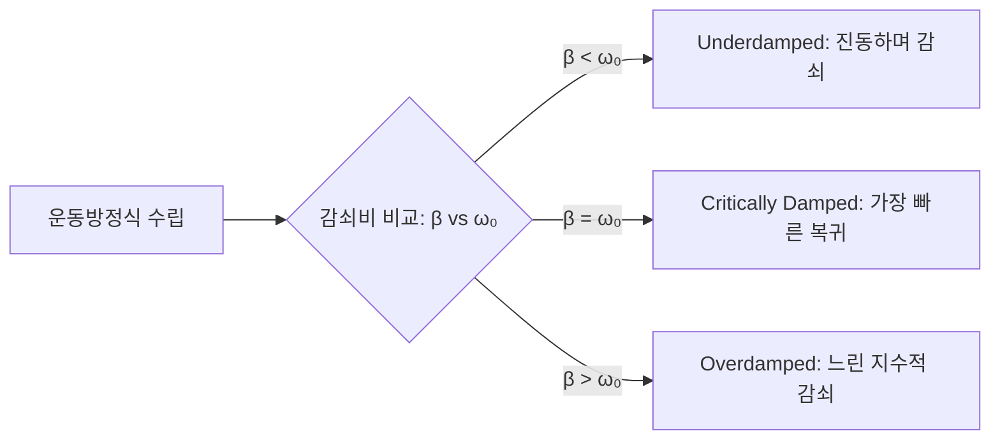

# Presentation — Damped Harmonic Oscillator & Phase Space

- **Presenter:** 홍길동 (Presenter 01)
- **Date:** 2026-10-18
- **Textbook:** Classical Mechanics (Taylor)
- **Chapters / Sections:** Ch 5.1 ~ 5.4

---

## 0. Overview & Motivation
- **핵심 질문:** 이상적인 단진자에 '마찰(감쇠력)'이 추가되면 시스템의 에너지와 궤적은 시간에 따라 어떻게 변할까?
- **전체 흐름:** 운동방정식 수립 $\to$ 감쇠비($\beta/\omega_0$)에 따른 3가지 해의 분류 $\to$ 위상 공간(Phase Space)에서의 기하학적 해석

---

## 1.Sec 5.1 Equation of Motion & Setup

### Concept / Setup
> **📌 Assumption:** 저항력(마찰력)은 속도에 선형적으로 비례하며 운동 방향과 반대로 작용한다 ($f_{\text{drag}} = -bv = -b\dot{x}$).

- **고유 진동수 (Natural Frequency):** $\omega_0 = \sqrt{k/m}$ (감쇠가 없을 때의 진동수)
- **감쇠 계수 (Damping Parameter):** $\beta = \frac{b}{2m}$ (단위 시간당 감쇠율 척도)

*▲ Figure 1: 용수철 상수 $k$와 감쇠기 $b$가 결합된 질량 $m$의 1차원 운동 모델 (AI Generated SVG)*

### Derivation / Proof
뉴턴 제2법칙 $m\ddot{x} = -kx - b\dot{x}$의 양변을 $m$으로 나누고 정리하면 제차 2계 선형 미분방정식을 얻습니다.

$$
\begin{aligned}
\ddot{x} + \frac{b}{m}\dot{x} + \frac{k}{m}x &= 0 \\
\implies \ddot{x} + \underbrace{2\beta\dot{x}}_{\text{에너지 소산항}} + \underbrace{\omega_0^2 x}_{\text{복원력항}} &= 0 \quad (\because 2\beta \equiv \frac{b}{m}, \omega_0^2 \equiv \frac{k}{m})
\end{aligned}
$$

해의 형태를 $x(t) = e^{rt}$로 가정(Ansatz)하여 대입하면 특성방정식(Characteristic Equation)의 두 근을 구할 수 있습니다.

$$
r = -\beta \pm \sqrt{\beta^2 - \omega_0^2}
$$

<b>🔍 특성방정식 대수적 유도 및 일반해 도출 과정 보기 (Click)</b>

1. $x(t) = e^{rt}$를 미분방정식에 대입하면:
   $$
   (r^2 + 2\beta r + \omega_0^2)e^{rt} = 0
   $$
2. 모든 $t$에 대해 $e^{rt} \neq 0$이므로 괄호 안의 2차 방정식이 $0$이 되어야 합니다. 근의 공식에 의해:
   $$
   r_{1,2} = -\beta \pm \sqrt{\beta^2 - \omega_0^2}
   $$
3. 따라서 $r_1 \neq r_2$일 때 일반해는 두 독립해의 선형 결합으로 주어집니다:
   $$
   x(t) = e^{-\beta t} \left( C_1 e^{\sqrt{\beta^2 - \omega_0^2}t} + C_2 e^{-\sqrt{\beta^2 - \omega_0^2}t} \right)
   $$

> **💡 Intuition:** 근호 안의 값 $\beta^2 - \omega_0^2$의 부호가 해의 성질을 완전히 결정합니다. 즉, **'감쇠하려는 힘($\beta$)'과 '진동하려는 힘($\omega_0$)'의 줄다리기**입니다.

---

## 2. Sec 5.2 ~ 5.4 Three Regimes & Visualization

판별식 $\beta^2 - \omega_0^2$의 부호에 따라 시스템은 세 가지 영역으로 나뉩니다:
- **Underdamped ($\beta < \omega_0$):** 근이 복소수가 되어 $\omega_1 = \sqrt{\omega_0^2 - \beta^2}$의 줄어든 진동수로 진동하며 포락선 $e^{-\beta t}$를 따라 감쇠합니다.
- **Critically Damped ($\beta = \omega_0$):** 중근 $r = -\beta$를 가지며, 진동 없이 가장 빠르게 평형점($x=0$)으로 수렴합니다.
- **Overdamped ($\beta > \omega_0$):** 두 실근을 가지며, 마찰이 너무 커서 평형점으로 돌아오는 데 오히려 오랜 시간이 걸립니다.

### Example & Visualization
- **예제 상황:** 초기 위치 $x(0) = 1$, 초기 속도 $\dot{x}(0) = 0$, 고유 진동수 $\omega_0 = 1$로 고정했을 때 $\beta \in \{0.2, 1.0, 2.5\}$에 따른 시간 응답 및 위상 공간($x$ vs $\dot{x}$) 궤적을 비교합니다.

*▲ Figure 2: 좌측은 시간에 따른 변위 $x(t)$, 우측은 위상 공간에서의 나선형 수렴 궤적 (Python matplotlib 생성)*

---

## 3. Summary & Discussion Points
- **Takeaway 1:** 선형 감쇠 진동자의 거동은 무차원 비율인 $\zeta = \beta / \omega_0$ 하나로 완벽히 결정된다.
- **Takeaway 2:** 위상 공간에서 보존계($\beta=0$)는 닫힌 타원을 그리지만, 감쇠계($\beta>0$)는 에너지가 소산되므로 원점(Attractor)으로 빨려 들어가는 나선(Spiral) 또는 직선 형태가 된다.

> **❓ Question / Discussion:** 자동차 서스펜션이나 도어 클로저를 설계할 때는 완벽한 임계 감쇠($\beta = \omega_0$)보다 약간 부족 감쇠($\beta \lesssim \omega_0$)를 선호하는 경우가 있다고 하는데, 실용적인 이유가 무엇일까요?