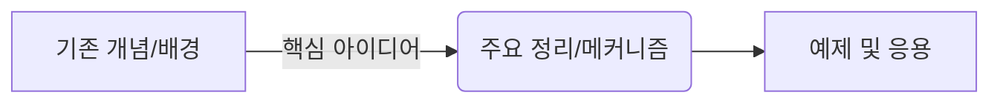

# Presentation — [Title]

- **Presenter:** 
- **Date:** YYYY-MM-DD
- **Textbook:** 
- **Chapters / Sections:** 

<!-- [AI 작성 및 시각 자료(Assets) 생성 지침]
     이 문서를 작성하거나 보조할 때, 독자의 직관적 이해를 돕기 위해 필요한 시각 자료를 적극 생성하세요.
     성격에 따라 아래 3가지 방식 중 가장 적합한 도구를 선택합니다:
     
     1. 알고리즘 흐름 / 개념 관계도 / 상태 전이: 마크다운 내에 ```mermaid 코드 블록으로 직접 작성
     2. 함수 개형 / 수식 플롯 / 시뮬레이션 결과: Python(matplotlib/numpy) 스크립트로 생성하여 `attachments/01-figX-설명.png`로 저장 후 연결
     3. 기하학적 모식도 / 물리적 시스템 직관: 깔끔한 SVG 코드로 생성(`attachments/01-figX-설명.svg`)하거나 이미지로 생성 후 연결
     * 주의: 모든 외부 저장 파일은 발표자 번호 접두사(예: `01-`, `02-`)를 붙여 파일명 충돌을 방지합니다. -->

---

## 0. Overview & Motivation
<!-- 오늘 다룰 범위의 핵심 질문과 전체적인 흐름(Big Picture)을 2~3줄로 요약합니다. -->
- **핵심 질문:** 
- **전체 흐름:** 



---

## 1. [Sec X.1 제목 또는 첫 번째 소주제]
<!-- 교재의 서술 순서에 맞춰 섹션을 나눕니다. -->

### Concept / Setup
> **📌 Definition / Assumption:** 반드시 짚고 넘어가야 할 핵심 정의나 기본 가정

- **핵심 키워드 1:** 설명 작성 ($x \in \mathbb{R}^d$)
- **핵심 키워드 2:** 설명 작성

<!-- [AI Asset Slot] 개념 이해를 돕는 기하학적 모식도나 구조도가 필요한 경우 아래 형식으로 추가 -->

*▲ Figure 1: (그림에 대한 간단한 캡션과 직관적 포인트 설명)*

### Derivation / Proof
<!-- 주요 수식 전개나 증명 과정을 작성합니다. -->
$$
\begin{aligned}
f(x) &= g(x) + h(x) \\
     &\approx \underbrace{A(x)}_{\text{물리적/수학적 의미 1}} + \underbrace{B(x)}_{\text{물리적/수학적 의미 2}} \quad (\because \text{근사 조건 또는 가정})
\end{aligned}
$$

<details>
<summary><b>🔍 상세 대수 계산 및 증명 과정 보기 (Click)</b></summary>

- 본문 흐름을 끊지 않기 위해 지엽적인 계산이나 긴 증명은 이곳에 접어둡니다.
- 스터디 중 질문이 나오거나 상세한 확인이 필요할 때 클릭해서 펼칩니다.

$$
\int_{-\infty}^{\infty} e^{-x^2} dx = \sqrt{\pi}
$$

</details>

> **💡 Intuition / Note:** 수식의 물리적·직관적 의미나 극한 상황에서의 거동, 행간의 보충 설명을 적습니다.

---

## 2. [Sec X.2 제목 또는 두 번째 소주제]
<!-- 섹션 성격에 따라 소제목(###) 없이 줄글과 수식으로 쭉 서술해도 무방합니다. -->

- 

### Example & Visualization
<!-- 예제의 수식 풀이뿐만 아니라, 결과 수식이 파라미터에 따라 어떻게 거동하는지 Python 플롯 등으로 시각화하여 첨부합니다. -->
- **예제 상황:** 
- **적용 결과:** 


*▲ Figure 2: 파라미터 변화에 따른 해의 거동 비교*

---

## 3. Selected Exercises (Optional)
<!-- 본문 흐름 중간에 다루기 애매한 연습문제나 추가 예제를 모아서 풀이합니다. -->
- **Exercise X.Y:** 문제 요약
  - **풀이 핵심:** 

---

## 4. Summary & Discussion Points
- **Takeaway 1:** 
- **Takeaway 2:** 

> **❓ Question / Discussion:** 공부하면서 헷갈렸던 부분이나 스터디원들과 함께 이야기해 보고 싶은 포인트

## 5. References (Optional)
- 